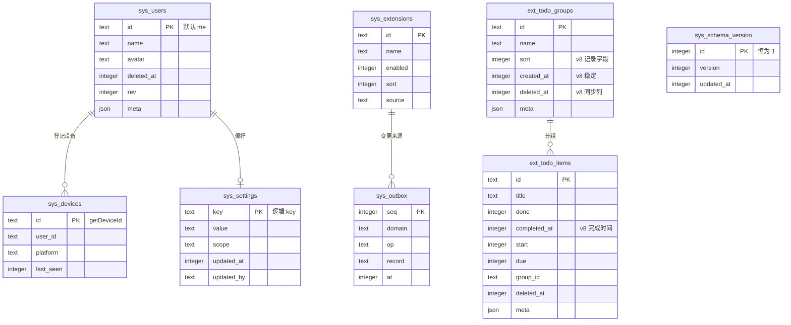

# WorkHub 数据库设计说明书（系统基座）

> ADR-002 · 权威设计文档 · 最后更新 2026-11-24
> 当前 schema 版本：**v8** · 实现文件：`js/db.js`
> 关联文档：[架构 ADR-003](architecture.md) · [界面样式 ADR-004](architecture.md) · [同步协议](sync-protocol.md)

---

## 1. 概述

### 1.1 背景

WorkHub 是零构建、本地优先（local-first）的前端工作台。数据库需同时满足：UI 读写零延迟、刷新不丢数据、可平滑扩展。

### 1.2 本文档范围（v7 收紧）

v7 起，数据库设计**只覆盖系统基座**：

- 系统表（`sys_`）：版本、用户、设备、设置、扩展注册、变更队列
- 先行保留的 TODO 扩展表（`ext_todo_items` / `ext_todo_groups`）
- 存储分层、meta、迁移机制、DAO 契约、同步现状

**不在基座范围内**（v7 已从内核删除）：

- 其余业务扩展表（项目/片段/客诉/笔记/博客/学习）——扩展需要时用 `declareDomain(table)` 自带表接入
- 家庭 / 组织模型表（`sys_households` / `sys_memberships`）——组织结构未定，后续另立通用组织架构设计
- 未接入的扩展机制表（`sys_ext_mounts` / `sys_ext_kv`）——挂载配置归偏好，数据归扩展自有表

### 1.3 修订历史

| 版本 | 日期 | 主要变更 |
|---|---|---|
| v1 | 2026-11-20 | 初始 schema：SQLite 选型、业务表、通用同步列、outbox |
| v2 | 2026-11-23 | 同步元数据列落地（`updated_at/by/deleted_at/rev/meta`） |
| v3 | 2026-11-23 | `todos.start` + 幂等列迁移 |
| v4 | 2026-11-23 | 表名规范 `sys_` / `ext_<id>_` + 表级迁移 |
| v5 | 2026-11-23 | 家庭/成员表与归属 meta（**v7 撤销**） |
| v6 | 2026-11-23 | 同步字段「独立列为真相源、meta 精简」 |
| v7 | 2026-11-24 | **裁剪到系统基座**：删扩展表/家庭表/未用机制表；版本表改单行约束；outbox 去 `pushed`；剥离 meta 归属字段 |
| v8 | 2026-11-24 | **TODO 表补齐**：待办加 `completed_at`；分组升为完整同步表（补 `updated_by/deleted_at/rev`）；`created_at` 稳定化、`sort` 提升为记录字段 |

---

## 2. 架构与选型

**SQLite（sql.js / WASM）**，整库导出字节存 IndexedDB。备选 PostgreSQL（单机运维过重）、原生 IndexedDB（无关系约束与迁移能力）均否决。

四层存储：

```
内存 state（data.js）         —— 运行时真相源，UI 零延迟读写
   ↕ store（localStorage）     —— 同步镜像 + 偏好快速读取
SQLite（sql.js WASM）        —— 持久化真相源、关系约束
   ↕ export / import
IndexedDB（workhub_db/db）   —— 字节 blob 落盘，页重载不丢
```

---

## 3. 设计原则

1. **真相源唯一**：同步字段以独立列为准（v6）；`meta` 只存未提升的扩展字段。
2. **不预设业务**：基座只做通用能力，业务表由扩展自带，避免"建了表却没人用"的空壳。
3. **幂等迁移**：所有迁移可重复执行；顺序敏感处（表名/版本读取）固定写在 SCHEMA 之前。
4. **单机优先**：无登录、无组织、无网络也可完整使用。
5. **meta 兜底演进**：低频字段先进 `meta`，查询密集后再提升为正式列。

---

## 4. 命名规范

### 4.1 表名（v4 起）

| 前缀 | 含义 | 数量 |
|---|---|---|
| `sys_` | 系统基座 | 6 |
| `ext_<扩展id>_` | 扩展自有表（由扩展声明） | 当前 2（todo） |

完整清单：

| 归属 | 表名 | 说明 |
|---|---|---|
| 系统 | `sys_schema_version` | schema 版本，单行 |
| 系统 | `sys_users` | 本地用户，默认 `me` |
| 系统 | `sys_devices` | 设备登记 |
| 系统 | `sys_settings` | 基座偏好 KV |
| 系统 | `sys_extensions` | 扩展注册表（声明式） |
| 系统 | `sys_outbox` | 本地变更队列 |
| todo | `ext_todo_items` | 待办 |
| todo | `ext_todo_groups` | 待办分组 |

扩展表命名约束：`^ext_[a-z][a-z0-9]*(_[a-z0-9]+)+$`（`registerDomain` 校验，防标识符注入）。

### 4.2 localStorage key

物理 key 与表名对应，映射在 `base.js` 的 `storageKey()`：

| 逻辑 key | 物理 key |
|---|---|
| 业务域（`todos`/`todoGroups`） | `wh_ext_todo_items` / `wh_ext_todo_groups` |
| 偏好/身份 | `wh_sys_settings_<key>` |
| 未登记未来域 | `wh_<logical>`（兜底） |

偏好键（`PREF_KEYS`）：`theme` `skin` `skinMounts` `skinPoints` `menuLayout` `extEnabled` `rightCollapsed` `shortcuts` `searchRules` `links` `currentUserId` `currentUserName` `deviceId`。

---

## 5. ER 图



> 关系为逻辑外键（SQLite 未开启外键约束）。省略了各表的时间戳与 meta 列。

---

## 6. 数据表详解

### 6.1 `sys_schema_version`

单行版本标记。`id` 恒为 1 且有 `CHECK` 约束 + 主键，`INSERT OR IGNORE` 真正幂等——修复旧版 `version` 无唯一约束导致每次启动累积多行的缺陷。

| 列 | 类型 | 约束 | 说明 |
|---|---|---|---|
| id | INTEGER | PK, CHECK(id=1) | 恒为 1 |
| version | INTEGER | NOT NULL | 当前 8 |
| updated_at | INTEGER | 可空 | 写入时间 |

### 6.2 `sys_users`

本地用户。单机只有一行 `me`；保留 `deleted_at/rev/meta` 以便将来同步。

| 列 | 类型 | 约束 | 说明 |
|---|---|---|---|
| id | TEXT | PK | 默认 `me` |
| name | TEXT | NOT NULL DEFAULT '我' | 显示名 |
| avatar | TEXT | 可空 | 头像 |
| created_at / updated_at | INTEGER | 可空 | 时间戳 |
| deleted_at | INTEGER | 可空 | 软删墓碑 |
| rev | INTEGER | DEFAULT 1 | 版本 |
| meta | TEXT | 可空 | JSON 扩展字段 |

### 6.3 `sys_devices`

设备登记，`getDeviceId()` 幂等写入；LWW 平局用设备 ID 打破。

| 列 | 类型 | 约束 | 说明 |
|---|---|---|---|
| id | TEXT | PK | `dev_` 前缀 |
| user_id | TEXT | 可空（逻辑 FK） | 归属用户 |
| platform / label | TEXT | 可空 | 平台标识与可读名 |
| first_seen / last_seen | INTEGER | 可空 | 首次 / 最近活跃 |
| meta | TEXT | 可空 | JSON |

### 6.4 `sys_settings`

基座偏好 KV，`value` 为 JSON。

| 列 | 类型 | 约束 | 说明 |
|---|---|---|---|
| key | TEXT | PK | 逻辑 key（`theme`、`extEnabled`…） |
| value | TEXT | 可空 | JSON 序列化值 |
| scope | TEXT | NOT NULL DEFAULT 'user' | `user` / `device` / `global`（为将来同步预留） |
| updated_at | INTEGER | 可空 | 更新时间 |
| updated_by | TEXT | 可空 | 写入设备 ID（v7 起真实写入） |
| meta | TEXT | 可空 | JSON |

> 特殊行：`v2_imported='1'` 为历史数据导入完成标记。

### 6.5 `sys_extensions`

扩展注册表，声明式登记已注册扩展，新增扩展零改表。

| 列 | 类型 | 约束 | 说明 |
|---|---|---|---|
| id | TEXT | PK | 扩展 ID |
| name | TEXT | 可空 | 扩展名 |
| enabled | INTEGER | NOT NULL DEFAULT 1 | 启用态（`store.extEnabled` 的投影） |
| sort | INTEGER | DEFAULT 0 | 排序 |
| source | TEXT | DEFAULT 'builtin' | 来源 |
| created_at / updated_at | INTEGER | 可空 | 时间戳 |
| meta | TEXT | 可空 | JSON |

### 6.6 `sys_outbox`

本地变更队列，写入即入队并落库；push 成功后 ack 删除行。

| 列 | 类型 | 约束 | 说明 |
|---|---|---|---|
| seq | INTEGER | PK AUTOINCREMENT | 序号 |
| domain | TEXT | NOT NULL | 领域名 |
| op | TEXT | NOT NULL | `upsert` / `delete` |
| record | TEXT | NOT NULL | 记录快照 JSON |
| at | INTEGER | NOT NULL | 入队时间 |

> v7 删除恒为 0 的 `pushed` 列（ack 直接删行，列无意义）。

### 6.7 `ext_todo_items` / `ext_todo_groups`

TODO 扩展自有表，用户要求先行保留。v8 已完成对称性修复：

| 修复项 | 之前（v7） | 现在（v8） |
|---|---|---|
| 分组同步列 | 仅 `updated_at`，`deletedAt/rev/updatedBy` 留 `meta` | **完整四列**，与待办表对齐，`SYNC_TABLE_PROMOTED` 用 `SYNC_ALL` |
| 完成时间 | 无（`done` 仅布尔） | 新增 `completed_at`：完成时写时间戳、取消时清空；历史已完成记录用 `updated_at` 近似回填 |
| 分组 `created_at` | 每次落库被覆盖为 `Date.now()` | 来自记录字段 `created`，稳定；迁移时用组内最早待办创建时间回填 |
| 分组 `sort` | 落库取数组下标，不随记录同步 | 提升为记录字段，可随 LWW 同步；新增分组取 `max(sort)+1` |

> 历史 `completed_at` 是近似值（用最后更新时间），无法还原真实完成时刻，仅影响 v8 之前的数据。

---

## 7. 通用字段与 meta

**同步字段（v6 起独立列为真相源）**：`updated_at` / `updated_by` / `deleted_at` / `rev`。

- v8 起两张 TODO 表都是完整四列表，四列均落地；`PK_ONLY_UPDATED` 仅作为 `slimMeta/fromMeta` 的默认参数保留（无表使用）。
- `meta` 只存未提升的扩展字段；`slimMeta()` 落库前剔除同步字段与**归属字段**，`fromMeta()` 读回时以独立列覆盖。

**已撤销的归属字段**（v7）：`userId` / `ownerId` / `scope` / `householdId` 不再写入；迁移时从历史记录中剥离，`slimMeta`/`fromMeta` 亦防御性剔除，避免备份或远端带回。

---

## 8. 写路径与数据流

```
insert/update/remove(data.js)
  → state（内存真相源）
  → store.set（localStorage 镜像，逻辑 key → 物理 key）
  → adapter.persistDomain（SQLite 整域重写）
  → sync.enqueue（sys_outbox 落库）
  → bus.emit('data')（按扩展声明的 domains 精确重绘）
```

偏好写走 `store.set` → `bus.emit('pref')` → `mirrorPref` 写 `sys_settings`（并同步 `sys_extensions.enabled` 投影）。

---

## 9. 迁移机制

| 类型 | 函数 | 说明 |
|---|---|---|
| 表名 | `migrateTableNames` | v3 无前缀表 → `sys_`/`ext_` 规范名 |
| 列 | `migrateColumns` | `PRAGMA table_info` 判缺列后 `ALTER TABLE`，按 id 从镜像回填 |
| meta | `migrateSlimMeta` | v5→v6 清理 meta 中重复的同步字段 |
| 基座裁剪 | `migrateV7` | 删表、重建 outbox、剥离归属 meta、版本表升级 |
| TODO 补齐 | `migrateV8` | 加 `completed_at` 与分组三同步列、从 meta 回填、`created_at` 稳定化、版本升 8 |

**顺序（勿调换）**：

1. `migrateTableNames()` —— 在 SCHEMA 之前，否则新空表占位使迁移判据失效
2. 读取 `prevVer` —— 在 SCHEMA 之前，否则被新写入的版本顶替
3. `migrateV7()`（`saved && prevVer < 7`）—— 在 SCHEMA 之前，它 DROP 版本表与 outbox 交由 SCHEMA 重建
4. `db.run(SCHEMA)`
5. `migrateV8()`（`saved && prevVer < 8`）—— **必须在 SCHEMA 之后**：SCHEMA 对已存在的旧表不改结构，加列只能靠 ALTER
6. 扩展自带表建表 → `migrateColumns` → `migrateSlimMeta`（`prevVer < 6`）
7. 回读 state；迁移过的库必须**从 DB 回读**，不能被 localStorage 空镜像覆盖

**幂等**：删表用 `DROP TABLE IF EXISTS`；加列先判 `PRAGMA table_info`；版本表每次启动 `INSERT OR IGNORE`；v8 版本用 `UPDATE ... SET version=8` 显式推进。

---

## 10. DAO 与适配器契约

`storage.js` 只暴露：`init / persist / flush / exportBytes / outbox*`。

- 内置域（todos/todoGroups）：`db.js` 手写行级列映射（`M`）。
- 扩展域：`declareDomain(name, seed, { table })` → 适配器自动建表，记录存 `doc` JSON 列 + 同步元数据独立列，扩展无需改 `db.js`。
- 写放大：`persistDomain` 仍为整域 `DELETE + INSERT`，个人规模够用；多端高频同步前改行级 upsert。

---

## 11. 同步设计（现状）

- `sync.js` 为 v1 骨架：无 CloudAdapter 时 `push/pull` 安全 no-op。
- 已就绪：outbox 落库与恢复、HLC 单调时间戳、LWW 合并、墓碑安全清理、增量游标。
- 未就绪：云端适配器、真实端到端往返。详见 [sync-protocol.md](sync-protocol.md)。

---

## 12. 索引

| 索引 | 表 | 列 |
|---|---|---|
| `idx_ext_todo_items_group` | `ext_todo_items` | `group_id` |

`sys_outbox` 按 `seq` 主键顺序读取，无需额外索引。

---

## 13. 验证记录（2026-11-24）

`npm test` 41 项全通过，覆盖：

- v6 库 → 最新：连续执行 v7+v8；`sys_households`/`sys_memberships`/`sys_ext_mounts`/`sys_ext_kv`/`ext_projects`/`ext_notes_nodes` 全部删除；归属字段剥离；版本收敛到单行 `version=8`；`sys_outbox` 保留未推送条目且无 `pushed` 列
- v7 库 → v8：分组补齐三同步列并从 meta 回填（含 `rev`/`updatedBy`）、`created_at` 稳定化为组内最早待办创建时间、待办 `completed_at` 用 `updated_at` 近似回填
- 新库行为：完成态切换维护 `completedAt`、分组 `sort`/`created` 落库后刷新稳定
- 既有用例：落盘/刷新恢复、墓碑不复活、v3 表名迁移、扩展自带表、导出 SQLite 原始字节

---

## 14. 风险与演进

| 风险 / 缺口 | 缓解 / 计划 |
|---|---|
| 整域重写写放大 | 多端高频同步前改行级 upsert |
| 记录级 LWW 丢一端编辑 | 笔记类未来升级字段级 / CRDT |
| 无 CloudAdapter | 后端就绪后注入，outbox 已可持久化 |
| 组织架构未定 | 家庭模型已撤销，后续另立通用组织结构设计（用户/组织/可见性重新建模） |
| 扩展表建了却没人用 | v7 已清除空壳；今后扩展数据由扩展自带表，基座不预设 |
| 历史 `completed_at` 为近似值 | v8 前已完成的待办无法还原真实完成时刻，用 `updated_at` 回填；仅影响迁移数据 |
| `v2_imported` 等内部标记混在 settings | 暂保留（不影响偏好回灌），后续可独立 `sys_meta` |

---

## 附录 A：完整建表 SQL（v8）

```sql
CREATE TABLE IF NOT EXISTS sys_schema_version (
  id INTEGER PRIMARY KEY CHECK (id = 1), version INTEGER NOT NULL, updated_at INTEGER);

CREATE TABLE IF NOT EXISTS sys_users (
  id TEXT PRIMARY KEY, name TEXT NOT NULL DEFAULT '我', avatar TEXT,
  created_at INTEGER, updated_at INTEGER, deleted_at INTEGER, rev INTEGER DEFAULT 1, meta TEXT);

CREATE TABLE IF NOT EXISTS sys_devices (
  id TEXT PRIMARY KEY, user_id TEXT, platform TEXT, label TEXT,
  first_seen INTEGER, last_seen INTEGER, meta TEXT);

CREATE TABLE IF NOT EXISTS sys_settings (
  key TEXT PRIMARY KEY, value TEXT, scope TEXT NOT NULL DEFAULT 'user',
  updated_at INTEGER, updated_by TEXT, meta TEXT);

CREATE TABLE IF NOT EXISTS sys_extensions (
  id TEXT PRIMARY KEY, name TEXT, enabled INTEGER NOT NULL DEFAULT 1,
  sort INTEGER DEFAULT 0, source TEXT DEFAULT 'builtin',
  created_at INTEGER, updated_at INTEGER, meta TEXT);

CREATE TABLE IF NOT EXISTS sys_outbox (
  seq INTEGER PRIMARY KEY AUTOINCREMENT, domain TEXT NOT NULL, op TEXT NOT NULL,
  record TEXT NOT NULL, at INTEGER NOT NULL);

CREATE TABLE IF NOT EXISTS ext_todo_items (
  id TEXT PRIMARY KEY, title TEXT NOT NULL, done INTEGER NOT NULL DEFAULT 0,
  priority TEXT DEFAULT 'medium', start INTEGER, due INTEGER, note TEXT DEFAULT '',
  group_id TEXT, tags TEXT, created_at INTEGER, completed_at INTEGER, updated_at INTEGER,
  updated_by TEXT, deleted_at INTEGER, rev INTEGER DEFAULT 1, meta TEXT);

CREATE TABLE IF NOT EXISTS ext_todo_groups (
  id TEXT PRIMARY KEY, name TEXT NOT NULL, sort INTEGER DEFAULT 0,
  created_at INTEGER, updated_at INTEGER, updated_by TEXT,
  deleted_at INTEGER, rev INTEGER DEFAULT 1, meta TEXT);

CREATE INDEX IF NOT EXISTS idx_ext_todo_items_group ON ext_todo_items(group_id);
```
