# WorkHub 数据库设计说明书

> ADR-002 · 权威设计文档 · 最后更新 2026-11-23
> 当前 schema 版本：**v6** · 实现文件：`js/db.js`
> 关联文档：[架构 ADR-003](architecture.md) · [界面样式 ADR-004](architecture.md) · [多用户 ADR-005](multi-user-design.md) · [同步协议](sync-protocol.md)

---

## 目录

1. [概述](#1-概述)
2. [架构与选型](#2-架构与选型)
3. [设计原则](#3-设计原则)
4. [命名规范](#4-命名规范)
5. [总体 ER 图](#5-总体-er-图)
6. [数据表详解](#6-数据表详解)
7. [通用字段与 meta 结构](#7-通用字段与-meta-结构)
8. [存储层次与 localStorage 映射](#8-存储层次与-localstorage-映射)
9. [写路径与数据流](#9-写路径与数据流)
10. [迁移机制](#10-迁移机制)
11. [DAO 与适配器契约](#11-dao-与适配器契约)
12. [同步设计](#12-同步设计)
13. [多用户协作预留](#13-多用户协作预留)
14. [索引设计](#14-索引设计)
15. [验证记录](#15-验证记录)
16. [后果、风险与演进](#16-后果风险与演进)
17. [附录 A：完整建表 SQL](#附录-a完整建表-sql)

---

## 1. 概述

### 1.1 背景

WorkHub 是一个零构建的纯前端本地优先（local-first）工作台。数据需要满足三个看似矛盾的目标：

1. **即时响应**：UI 读写零延迟，不等待任何网络或异步存储
2. **本地持久化**：刷新、关闭重开后数据不丢
3. **面向未来**：随时可加新扩展、可升级为多用户家庭工作台、可接入云端多端同步

### 1.2 本文档范围

本文档描述 WorkHub 的**本地数据库设计**，包括：

- SQLite schema（21 张表）与逐列定义
- 三层存储架构与 localStorage key 规范
- 写路径、meta 元数据、三类迁移机制
- 同步预留与多用户协作预留

不在本文档范围：云端表结构（待 CloudAdapter 接入时另立 ADR）、同步协议细则（见 `sync-protocol.md`）、多用户完整规则（见 `multi-user-design.md`）。

### 1.3 修订历史

| 版本 | 日期 | 主要变更 |
|---|---|---|
| v1 | 2026-11-20 | 初始 schema：选型 SQLite、业务表、通用同步列、outbox |
| v2 | 2026-11-23 | 同步元数据列落地（updated_at/by/deleted_at/rev/meta） |
| v3 | 2026-11-23 | `todos.start` 字段 + 幂等列迁移；`v2_imported` 自愈 |
| v4 | 2026-11-23 | 表名规范：`sys_`/`ext_<id>_` 前缀 + 表级迁移 |
| v5 | 2026-11-23 | 家庭/成员表、归属 meta、localStorage key 与表名对应 |
| v6 | 2026-11-23 | 同步字段「独立列为真相源、meta 精简」：剔除 meta 中重复同步字段 |

---

## 2. 架构与选型

### 2.1 选型决策

**选型：SQLite（WAL 模式）**，通过 `sql.js`（SQLite 编译为 WASM）在浏览器内运行，整库导出为字节 blob 存入 IndexedDB。

| 备选 | 结论 | 理由 |
|---|---|---|
| PostgreSQL 直连 | ❌ 否决 | 单机桌面壳场景运维过重，离线不可用 |
| 原生 IndexedDB | ❌ 否决 | 无关系约束、无 SQL 演进能力、无迁移工具链 |
| **SQLite + WASM** | ✅ 采用 | 桌面端内嵌零运维；schema 与未来服务端同构，可平滑对接同步网关 |

### 2.2 三层存储架构

```
┌─────────────────────────────────────────────────────────┐
│ 层 1：内存 state（data.js）        —— 运行时真相源      │
│       UI 读写直接命中，零延迟                            │
└─────────────────────────────────────────────────────────┘
                    ↕ 同步写入 / 启动恢复
┌─────────────────────────────────────────────────────────┐
│ 层 2：localStorage（core.store）  —— 同步镜像 + 恢复源  │
│       物理 key 与表名对应（wh_ext_todo_items 等）        │
└─────────────────────────────────────────────────────────┘
                    ↕ persistDomain / initDb
┌─────────────────────────────────────────────────────────┐
│ 层 3：SQLite（sql.js WASM）        —— 持久化真相源      │
│       关系约束、SQL 查询、同步载体                        │
└─────────────────────────────────────────────────────────┘
                    ↕ 整库 export/import
┌─────────────────────────────────────────────────────────┐
│ 层 4：IndexedDB（workhub_db / db store / key 'sqlite'） │
│       字节 blob 落盘，页重载不丢                          │
└─────────────────────────────────────────────────────────┘
```

**关键理解**：SQLite 是"恢复真相源"——启动时 `initDb` 用 SQLite 数据覆盖内存 state。localStorage 主要承担同步写入与偏好快速读取的职责（详见 [§9](#9-写路径与数据流)）。

### 2.3 存储实现要点

- `js/db.js` 用 `sql.js WASM + IndexedDB`：数据库整体导出为 bytes blob，存于 IndexedDB 数据库 `workhub_db` 的 `db` objectStore，key 为 `sqlite`
- 业务域采用**整域重写**：`persistDomain()` 对单个领域 `DELETE FROM table` 后逐行 `INSERT`（个人规模足够；多端高频同步应改行级 upsert）
- `scheduleSave()` 用防抖定时器整库写回 IndexedDB

---

## 3. 设计原则

### 3.1 扩展性三原则

| 原则 | 机制 |
|---|---|
| 新扩展不改表 | 业务数据 = 专用表（官方扩展）+ `sys_ext_kv` 沙箱 KV（第三方/轻量）；扩展中心登记走 `sys_extensions` 声明式表 |
| 字段演进不迁移 | 各表预留 `meta TEXT` JSON 列，低频字段先进 meta，高频字段提升为正式列 + `COLUMN_MIGRATIONS` 幂等补列 |
| 真相源唯一（v6） | 同步字段以**独立列**为唯一真相源，`meta` 不再重复存已提升字段，杜绝双写漂移 |
| 多端同步零重构 | 需要的表统一 `updated_at/updated_by/deleted_at/rev`，软删除墓碑 + LWW 冲突策略 |

### 3.2 单机优先，未来兼容

- 默认用户 `me`、默认家庭 `home`、默认可见范围 `private`
- 不弹登录、不增加单机用户可见的界面
- 所有多用户 API 都是可选调用，不调用时行为等同旧版

---

## 4. 命名规范

### 4.1 表名规范（v4 起）

所有表名集中在 `js/db.js` 的 `TABLES` 常量（`Object.freeze`）登记，分两类前缀：

| 前缀 | 含义 | 格式 | 数量 |
|---|---|---|---|
| `sys_` | 系统内置基座表：用户、家庭、设备、设置、扩展机制、变更日志 | `sys_<职责>` | 10 |
| `ext_<扩展id>_` | 扩展功能表，按扩展归属划分命名空间 | `ext_<扩展id>_<实体>` | 11 |

**完整表名清单：**

| 分类 | 归属 | 表名 | 说明 |
|---|---|---|---|
| 系统 | — | `sys_schema_version` | schema 版本（当前 v6） |
| 系统 | — | `sys_users` | 用户，单人默认 `me` |
| 系统 | — | `sys_households` | 家庭/协作空间，默认 `home` |
| 系统 | — | `sys_memberships` | 家庭成员关系（role=owner/member） |
| 系统 | — | `sys_devices` | 设备，按 `getDeviceId()` 登记 |
| 系统 | — | `sys_settings` | 基座偏好/身份 KV |
| 系统 | — | `sys_extensions` | 扩展注册表（声明式） |
| 系统 | — | `sys_ext_mounts` | 扩展在各皮肤挂载点的绑定 |
| 系统 | — | `sys_ext_kv` | 第三方扩展沙箱 KV |
| 系统 | — | `sys_outbox` | 变更日志 |
| 扩展 | todo | `ext_todo_items` | 待办 |
| 扩展 | todo | `ext_todo_groups` | 待办分组 |
| 扩展 | projects | `ext_projects` | 项目 |
| 扩展 | projects | `ext_project_tasks` | 项目子任务 |
| 扩展 | snippets | `ext_snippets` | 代码片段 |
| 扩展 | complaints | `ext_complaints` | 客诉工单 |
| 扩展 | complaints | `ext_complaint_events` | 客诉处理记录 |
| 扩展 | notes | `ext_notes_nodes` | 笔记树节点 |
| 扩展 | notes | `ext_notes_versions` | 笔记变更历史 |
| 扩展 | blog | `ext_blog_posts` | 博客文章 |
| 扩展 | learning | `ext_learning` | 学习项 |

**新增扩展约定**：在 `TABLES` 登记 `ext_<id>_<实体>` + SCHEMA 加建表语句即可，与系统表命名空间互不冲突。

### 4.2 localStorage key 规范（v5 起）

物理 key 与 SQLite 表名一一对应，映射集中在 `js/core.js` 的 `storageKey()`；业务代码传**逻辑 key**，调用方零改动：

| 逻辑 key 类型 | 物理 key 格式 | 示例 |
|---|---|---|
| 业务域 | `wh_<表名>` | `todos` → `wh_ext_todo_items` |
| 偏好/身份 | `wh_sys_settings_<key>` | `theme` → `wh_sys_settings_theme` |
| 未登记的未来域 | `wh_<逻辑key>`（兼容兜底） | `foo` → `wh_foo` |

业务域映射表（`DOMAIN_TABLE`）：`todos`、`todoGroups`、`projects`、`tasks`、`snippets`、`complaints`、`notes`、`posts`、`learning`。

偏好/身份集合（`PREF_KEYS`）：`theme`、`skin`、`skinMounts`、`skinPoints`、`menuLayout`、`extEnabled`、`rightCollapsed`、`shortcuts`、`searchRules`、`links`、`currentUserId`、`currentUserName`、`currentHouseholdId`、`currentHouseholdName`、`defaultScope`、`deviceId`。

> 注意：`bus.emit('pref', {key, value})` 仍发**逻辑 key**，因为 `db.js` 的 `mirrorPref`/`BASE_PREF_KEYS` 依赖逻辑 key 写 `sys_settings` 表。映射只发生在物理存储层。

---

## 5. 总体 ER 图

```mermaid
erDiagram
    sys_users ||--o{ sys_memberships : "加入家庭"
    sys_households ||--o{ sys_memberships : "拥有成员"
    sys_users ||--o{ sys_devices : "拥有设备"
    sys_users ||--o| sys_settings : "偏好归属"
    sys_extensions ||--o{ sys_ext_mounts : "挂载到皮肤点位"
    sys_extensions ||--o{ sys_ext_kv : "沙箱命名空间"
    ext_projects ||--o{ ext_project_tasks : "包含"
    ext_todo_groups ||--o{ ext_todo_items : "分组"
    ext_complaints ||--o{ ext_complaint_events : "处理记录"
    ext_notes_nodes ||--o{ ext_notes_nodes : "父子目录"
    ext_notes_nodes ||--o{ ext_notes_versions : "变更历史"

    sys_users {
        text id PK "单人默认 me"
        text name
        text avatar
        integer deleted_at
        integer rev
        json meta
    }
    sys_households {
        text id PK "单机默认 home"
        text name
        text owner_id FK
        integer deleted_at
        integer rev
        json meta
    }
    sys_memberships {
        text id PK
        text user_id FK "UNIQUE user_id+household_id"
        text household_id FK
        text role "owner/member"
        integer joined_at
    }
    sys_devices {
        text id PK "getDeviceId"
        text user_id FK
        text platform
        integer last_seen
    }
    sys_settings {
        text key PK "theme/extEnabled 等逻辑 key"
        text value
        text scope "user/device/global"
        integer updated_at
    }
    sys_extensions {
        text id PK
        text name
        integer enabled "store.extEnabled 投影"
        real sort
        text source
    }
    sys_ext_mounts {
        text id PK
        text skin_id "UNIQUE skin_id+point_id"
        text point_id
        text ext_id FK
    }
    sys_ext_kv {
        text id PK
        text ext_id "UNIQUE ext_id+key"
        text key
        text value
    }
    ext_projects {
        text id PK
        text name
        integer is_active
    }
    ext_todo_items {
        text id PK
        text title
        integer done
        integer start "v3 开始时间"
        integer due
        text group_id FK
        integer deleted_at
        json meta
    }
    ext_todo_groups {
        text id PK
        text name
        integer sort
    }
```



> 图中省略了同步通用列（updated_at/by/deleted_at/rev/meta）与部分低频字段，完整列定义见 [§6](#6-数据表详解)。

---

## 6. 数据表详解

> 约定：所有时间字段为 Unix 毫秒时间戳（`INTEGER`）；`meta TEXT` 为 JSON 字符串。类型标注 `TEXT/INTEGER/REAL` 为 SQLite 亲和类型。

### 6.1 系统内置表

#### 6.1.1 `sys_schema_version`

记录当前 schema 版本，仅一行。

| 列 | 类型 | 约束 | 说明 |
|---|---|---|---|
| version | INTEGER | NOT NULL | 当前值 5；`INSERT OR IGNORE` 写入，幂等 |

#### 6.1.2 `sys_users`

用户表，单人默认一行 `me`。

| 列 | 类型 | 约束 | 说明 |
|---|---|---|---|
| id | TEXT | PRIMARY KEY | 用户 ID，默认 `me` |
| name | TEXT | NOT NULL DEFAULT '我' | 显示名 |
| avatar | TEXT | 可空 | 头像（未来） |
| created_at | INTEGER | 可空 | 创建时间 |
| updated_at | INTEGER | 可空 | 更新时间 |
| deleted_at | INTEGER | 可空 | 软删墓碑 |
| rev | INTEGER | DEFAULT 1 | 版本 |
| meta | TEXT | 可空 | JSON 扩展字段 |

#### 6.1.3 `sys_households`

家庭/协作空间，未来多用户升级的核心容器，单机默认一条 `home`。

| 列 | 类型 | 约束 | 说明 |
|---|---|---|---|
| id | TEXT | PRIMARY KEY | 家庭 ID，默认 `home` |
| name | TEXT | NOT NULL DEFAULT '我的家' | 家庭名 |
| owner_id | TEXT | 可空（逻辑 FK→sys_users） | 所有者用户 ID |
| created_at / updated_at / deleted_at | INTEGER | 可空 | 同步通用列 |
| rev | INTEGER | DEFAULT 1 | 版本 |
| meta | TEXT | 可空 | JSON 扩展字段 |

#### 6.1.4 `sys_memberships`

用户在家庭中的成员关系，唯一约束保证一个用户在一个家庭只有一条记录。

| 列 | 类型 | 约束 | 说明 |
|---|---|---|---|
| id | TEXT | PRIMARY KEY | 形如 `m_<userId>_<householdId>` |
| user_id | TEXT | NOT NULL，UNIQUE(user_id,household_id) | 用户 ID |
| household_id | TEXT | NOT NULL，同上唯一约束 | 家庭 ID |
| role | TEXT | NOT NULL DEFAULT 'member' | `owner` / `member` |
| joined_at | INTEGER | 可空 | 加入时间 |
| updated_at | INTEGER | 可空 | 更新时间 |
| meta | TEXT | 可空 | JSON 扩展字段 |

#### 6.1.5 `sys_devices`

设备表，按 `getDeviceId()` 幂等登记，LWW 平局判定用设备 ID。

| 列 | 类型 | 约束 | 说明 |
|---|---|---|---|
| id | TEXT | PRIMARY KEY | 设备 ID（`dev_` 前缀） |
| user_id | TEXT | 可空（逻辑 FK→sys_users） | 归属用户 |
| platform | TEXT | 可空 | 平台标识（web/pwa/electron/...） |
| label | TEXT | 可空 | 平台可读名 |
| first_seen / last_seen | INTEGER | 可空 | 首次/最近活跃时间 |
| meta | TEXT | 可空 | JSON 扩展字段 |

#### 6.1.6 `sys_settings`

基座偏好与身份 KV 表，逻辑 key 为主键，value 存 JSON。

| 列 | 类型 | 约束 | 说明 |
|---|---|---|---|
| key | TEXT | PRIMARY KEY | 逻辑 key（如 `theme`、`extEnabled`） |
| value | TEXT | 可空 | JSON 序列化值 |
| scope | TEXT | NOT NULL DEFAULT 'user' | `user` / `device` / `global` |
| updated_at | INTEGER | 可空 | 更新时间 |
| updated_by | TEXT | 可空 | 写入设备 ID |
| meta | TEXT | 可空 | JSON 扩展字段 |

> 特殊行：`v2_imported='1'` 作为历史数据导入完成标记。

#### 6.1.7 `sys_extensions`

扩展注册表，声明式登记已注册扩展，新增扩展零改表。

| 列 | 类型 | 约束 | 说明 |
|---|---|---|---|
| id | TEXT | PRIMARY KEY | 扩展 ID（如 `todo`） |
| name | TEXT | 可空 | 扩展名 |
| enabled | INTEGER | NOT NULL DEFAULT 1 | 启用态，是 `store.extEnabled` 的投影 |
| sort | REAL | DEFAULT 0 | 排序权重 |
| source | TEXT | DEFAULT 'builtin' | `builtin` / 未来 `third-party` |
| created_at / updated_at | INTEGER | 可空 | 时间戳 |
| meta | TEXT | 可空 | JSON 扩展字段 |

#### 6.1.8 `sys_ext_mounts`

扩展在皮肤挂载点的绑定，唯一约束保证一个皮肤点位只挂一个扩展。

| 列 | 类型 | 约束 | 说明 |
|---|---|---|---|
| id | TEXT | PRIMARY KEY | 记录 ID |
| skin_id | TEXT | NOT NULL，UNIQUE(skin_id,point_id) | 皮肤 ID |
| point_id | TEXT | NOT NULL，同上 | 挂载点 ID |
| ext_id | TEXT | 可空（逻辑 FK→sys_extensions） | 绑定的扩展 ID |
| updated_at | INTEGER | 可空 | 更新时间 |
| meta | TEXT | 可空 | JSON 扩展字段 |

> 当前状态：表已建但行数=0，皮肤挂载仍走 `store.skinMounts`（见 [§15](#15-验证记录) 待办）。

#### 6.1.9 `sys_ext_kv`

第三方/轻量扩展的沙箱 KV，新增扩展无专用表时使用。

| 列 | 类型 | 约束 | 说明 |
|---|---|---|---|
| id | TEXT | PRIMARY KEY | 记录 ID |
| ext_id | TEXT | NOT NULL，UNIQUE(ext_id,key) | 扩展 ID 命名空间 |
| key | TEXT | NOT NULL，同上 | 键 |
| value | TEXT | 可空 | JSON 值 |
| updated_at | INTEGER | 可空 | 更新时间 |

#### 6.1.10 `sys_outbox`

变更日志，本地写操作入队，同步 push 消费；当前 DB 表已建，落库待 CloudAdapter 接入（现有队列在 `sync.js` 内存中）。

| 列 | 类型 | 约束 | 说明 |
|---|---|---|---|
| seq | INTEGER | PRIMARY KEY AUTOINCREMENT | 自增序号 |
| domain | TEXT | NOT NULL | 领域名（如 `todos`） |
| op | TEXT | NOT NULL | `upsert` / `delete` |
| record | TEXT | NOT NULL | JSON 记录快照 |
| at | INTEGER | NOT NULL | 入队时间 |
| pushed | INTEGER | NOT NULL DEFAULT 0 | 是否已推送 |

### 6.2 扩展功能表

#### 6.2.1 `ext_todo_items`

待办，TODO 扩展核心表。

| 列 | 类型 | 约束 | 说明 |
|---|---|---|---|
| id | TEXT | PRIMARY KEY | 待办 ID |
| title | TEXT | NOT NULL | 标题 |
| done | INTEGER | NOT NULL DEFAULT 0 | 完成标记 |
| priority | TEXT | DEFAULT 'medium' | `high`/`medium`/`low` |
| start | INTEGER | 可空 | 开始时间（v3 新增） |
| due | INTEGER | 可空 | 截止时间 |
| note | TEXT | DEFAULT '' | 备注 |
| group_id | TEXT | 可空（逻辑 FK→ext_todo_groups） | 分组，空=未分组 |
| tags | TEXT | 可空 | JSON 字符串数组 |
| created_at / updated_at / updated_by / deleted_at | — | 见 [§7](#7-通用字段与-meta-结构) | 同步通用列 |
| rev | INTEGER | DEFAULT 1 | 版本 |
| meta | TEXT | 可空 | JSON：完整同步元数据 + 归属字段 |

#### 6.2.2 `ext_todo_groups`

待办自定义分组，`sort` 用数组下标持久化。

| 列 | 类型 | 约束 | 说明 |
|---|---|---|---|
| id | TEXT | PRIMARY KEY | 分组 ID |
| name | TEXT | NOT NULL | 分组名 |
| sort | INTEGER | DEFAULT 0 | 排序 |
| created_at | INTEGER | 可空 | 创建时间 |
| updated_at | INTEGER | 可空 | 存 `meta.updatedAt`（软删墓碑由此保留） |
| meta | TEXT | 可空 | JSON：含 `deletedAt` 墓碑 |

#### 6.2.3 `ext_projects`

项目表。

| 列 | 类型 | 约束 | 说明 |
|---|---|---|---|
| id | TEXT | PRIMARY KEY | 项目 ID |
| name | TEXT | NOT NULL | 项目名 |
| stack / icon / url | TEXT | 可空 | 技术栈/图标/链接 |
| is_active | INTEGER | NOT NULL DEFAULT 1 | 是否活跃 |
| created_at + 同步通用列 + meta | — | 见 [§7](#7-通用字段与-meta-结构) | |

#### 6.2.4 `ext_project_tasks`

项目子任务表。

| 列 | 类型 | 约束 | 说明 |
|---|---|---|---|
| id | TEXT | PRIMARY KEY | 任务 ID |
| project_id | TEXT | 可空（逻辑 FK→ext_projects） | 所属项目 |
| title | TEXT | NOT NULL | 标题 |
| done | INTEGER | NOT NULL DEFAULT 0 | 完成标记 |
| priority | TEXT | DEFAULT 'medium' | 优先级 |
| created_at + 同步通用列 + meta | — | 见 [§7](#7-通用字段与-meta-结构) | |

#### 6.2.5 `ext_snippets`

代码片段表。

| 列 | 类型 | 约束 | 说明 |
|---|---|---|---|
| id | TEXT | PRIMARY KEY | 片段 ID |
| title / language / code | TEXT | 可空 | 标题/语言/代码 |
| tags | TEXT | 可空 | JSON 数组 |
| created_at + 同步通用列 + meta | — | 见 [§7](#7-通用字段与-meta-结构) | |

#### 6.2.6 `ext_complaints` / `ext_complaint_events`

客诉工单主表与处理记录子表（一对多）。

**ext_complaints：**

| 列 | 类型 | 约束 | 说明 |
|---|---|---|---|
| id | TEXT | PRIMARY KEY | 工单 ID |
| customer / title / severity / status / desc | TEXT | 可空 | 客户/标题/严重度/状态/描述 |
| created_at | INTEGER | 可空 | 创建时间 |
| resolved_at | INTEGER | 可空 | 解决时间 |
| updated_at | INTEGER | 可空 | 更新时间 |
| meta | TEXT | 可空 | JSON 扩展 |

**ext_complaint_events：**

| 列 | 类型 | 约束 | 说明 |
|---|---|---|---|
| id | TEXT | PRIMARY KEY | 记录 ID |
| complaint_id | TEXT | 可空（逻辑 FK） | 所属工单 |
| content | TEXT | 可空 | 处理内容 |
| created_at | INTEGER | 可空 | 时间 |
| meta | TEXT | 可空 | JSON 扩展 |

#### 6.2.7 `ext_notes_nodes` / `ext_notes_versions`

笔记邻接表树与变更历史。

**ext_notes_nodes：**

| 列 | 类型 | 约束 | 说明 |
|---|---|---|---|
| id | TEXT | PRIMARY KEY | 节点 ID |
| parent_id | TEXT | 可空（逻辑 FK，自引用） | 父节点，空=根 |
| type | TEXT | NOT NULL | `folder` / `note` |
| title | TEXT | 可空 | 标题（笔记的 name） |
| content | TEXT | 可空 | 正文（note 专用） |
| expanded | INTEGER | 可空 | folder 展开状态 |
| created_at / updated_at / meta | — | 见 [§7](#7-通用字段与-meta-结构) | |

**ext_notes_versions：**

| 列 | 类型 | 约束 | 说明 |
|---|---|---|---|
| id | TEXT | PRIMARY KEY | 版本 ID |
| node_id | TEXT | 可空（逻辑 FK） | 所属节点 |
| content | TEXT | 可空 | 历史正文 |
| created_at | INTEGER | 可空 | 时间 |
| meta | TEXT | 可空 | JSON 扩展 |

#### 6.2.8 `ext_blog_posts`

博客文章表。

| 列 | 类型 | 约束 | 说明 |
|---|---|---|---|
| id | TEXT | PRIMARY KEY | 文章 ID |
| title / content | TEXT | 可空 | 标题/正文 |
| status | TEXT | DEFAULT 'draft' | `draft` / `published` |
| created_at / updated_at / meta | — | 见 [§7](#7-通用字段与-meta-结构) | |

#### 6.2.9 `ext_learning`

学习项表。

| 列 | 类型 | 约束 | 说明 |
|---|---|---|---|
| id | TEXT | PRIMARY KEY | 学习项 ID |
| title / category | TEXT | 可空 | 标题/分类 |
| progress | INTEGER | DEFAULT 0 | 进度 0-100 |
| priority | INTEGER | DEFAULT 3 | 优先级 1-5 |
| created_at / updated_at / meta | — | 见 [§7](#7-通用字段与-meta-结构) | |

---

## 7. 通用字段与 meta 结构

### 7.1 同步通用列（v6：独立列为真相源）

业务表按同步字段的**提升程度**分两类，规则由 `db.js` 的 `SYNC_COL` / `SYNC_ALL` / `PK_ONLY_UPDATED` 声明：

| 列 | 类型 | 说明 | 哪类表拥有 |
|---|---|---|---|
| created_at | INTEGER | 创建时间（Unix ms） | 全部业务表 |
| updated_at | INTEGER | 最后修改时间，LWW 判定依据 | 全部业务表 |
| updated_by | TEXT | 最后写入设备 ID（`getDeviceId()`），LWW 平局判定 | 完整四列表 |
| deleted_at | INTEGER | 软删除墓碑时间，NULL=存活 | 完整四列表 |
| rev | INTEGER | 单调递增版本号 | 完整四列表 |
| meta | TEXT | JSON：**仅存未提升字段**（归属/扩展），不再重复同步字段 | 全部业务表 |

**两类表（v6）**：

- **完整四列表**（`ext_projects`、`ext_project_tasks`、`ext_snippets`、`ext_todo_items`）：拥有 `updated_at/updated_by/deleted_at/rev` 四列，同步字段全部提升。
- **仅提升 updated_at 表**（`ext_todo_groups`、`ext_complaints`、`ext_notes_nodes`、`ext_blog_posts`、`ext_learning`）：只有 `updated_at` 独立列，`deletedAt/rev/updatedBy` 等仍留在 `meta` JSON。

> **设计修正（v6）**：v5 及之前把同步字段**同时**写入独立列和 meta JSON，且 `fromMeta()` 中 meta 最后展开会覆盖独立列——导致独立列不是真相源、存在双写漂移风险。v6 起**独立列为唯一真相源**：落库时剔除已提升字段、读回时由独立列覆盖 meta。

### 7.2 `meta` JSON 结构

`metaCols(record)` 把已提升字段写入独立列，`meta` 只存剩余字段；`fromMeta(row, promoted)` 以 meta JSON 为底、独立列覆盖已提升字段：

```js
// 落库：剔除该表已提升的同步字段（slimMeta）
[meta.updatedAt, meta.updatedBy, meta.deletedAt, meta.rev,
 JSON.stringify(slimMeta(meta, SYNC_ALL))]   // meta 只存归属/扩展字段

// 读回：独立列覆盖（列为准，旧实现 meta 覆盖列的 bug 已修复）
const meta = { ...P(row.meta) };
for (const key of promoted) meta[key] = row[SYNC_COL[key]];
```

`newMeta()`（`js/data.js`）在**内存中**仍生成完整结构（业务层统一读 `meta.updatedAt` 等）：

```js
meta: {
  updatedAt:    Number,        // 最后修改时间（Unix ms），LWW 依据
  updatedBy:    String,        // 设备 ID（getDeviceId），平局判定
  deletedAt:    null | Number, // 软删墓碑
  rev:          Number,        // 版本号，递增
  userId:       String,        // 创建/最后修改者（单机=me），审计维度
  ownerId:      String,        // 归属用户（单机=me），见 ADR-005
  scope:        String,        // private | family | shared
  householdId:  String,        // 所属家庭（单机=home）
}
```

落库后 `meta` 列只保留 `userId/ownerId/scope/householdId` 等未提升字段（完整四列表），或加上 `deletedAt/rev/updatedBy`（仅提升 updated_at 表）。归属字段随 meta 整包落库，**不改业务表列、无需数据迁移**；未来按用户/家庭高频过滤时，再用 `COLUMN_MIGRATIONS` 提升为正式列并建索引。

### 7.3 软删除

删除是写 `deletedAt` 墓碑而非物理删除（保证能传播到其他端）。`alive(domain)` 过滤 `!meta.deletedAt`。墓碑超过 30 天由 `mergeDomain()` 物理清理。

- 完整四列表：墓碑时间落在 `deleted_at` 独立列，读回时由 `fromMeta()` 恢复到 `meta.deletedAt`。
- 仅提升 updated_at 表：`deletedAt` 保留在 `meta` JSON 内（如 `ext_todo_groups` 的软删墓碑），`fromMeta(r, PK_ONLY_UPDATED)` 不会清除它。

---

## 8. 存储层次与 localStorage 映射

完整映射表见 [§4.2](#42-localstorage-key-规范v5-起)。核心机制：

- `storageKey(logical)` 集中映射逻辑 key → 物理 key
- `store.get/set` 内部调用映射，业务代码传逻辑 key 即可
- `migrateStorageKeys()` 在 core.js 模块加载即执行，迁移老 key（详见 [§10.3](#103-localstorage-key-迁移v5)）

| localStorage 物理 key | 逻辑 key | SQLite 表 |
|---|---|---|
| wh_ext_projects | `projects` | ext_projects |
| wh_ext_project_tasks | `tasks` | ext_project_tasks |
| wh_ext_snippets | `snippets` | ext_snippets |
| wh_ext_todo_groups | `todoGroups` | ext_todo_groups |
| wh_ext_todo_items | `todos` | ext_todo_items |
| wh_ext_complaints | `complaints` | ext_complaints + ext_complaint_events |
| wh_ext_notes_nodes | `notes` | ext_notes_nodes + ext_notes_versions |
| wh_ext_blog_posts | `posts` | ext_blog_posts |
| wh_ext_learning | `learning` | ext_learning |
| wh_sys_settings_* | 偏好/身份 key | sys_settings |

---

## 9. 写路径与数据流

### 9.1 业务写路径

```
视图调用 DAO（insert/update/remove）
  → state[domain] 内存更新（UI 立即重绘）
  → store.set(domain, state[domain])   → localStorage 物理 key（wh_ext_*）
  → persist(domain, state[domain])     → db.persistDomain() 整域重写
      → BEGIN; DELETE FROM table; 逐行 INSERT; COMMIT
      → scheduleSave() 防抖整库导出 → IndexedDB blob
  → enqueue(domain, op, record)        → sync.outbox 入队
  → bus.emit('data')                   → 五区重绘
```

实现：`js/data.js` 的 `commit()` 是统一写路径，所有 DAO 都经它。

### 9.2 偏好写路径

```
core.store.set(key, value)            → localStorage 物理 key（wh_sys_settings_*）
  → bus.emit('pref', {key, value})     → 逻辑 key
  → db.mirrorPref()
      → INSERT OR REPLACE INTO sys_settings(...)
      → 若 key==='extEnabled'：同步 UPDATE sys_extensions.enabled
  → scheduleSave() → IndexedDB
```

### 9.3 启动恢复路径

```
core.js 模块加载        → migrateStorageKeys()（老 key 迁移，早于 data.js state 初始化）
data.js 模块加载        → state = store.get(各逻辑 key)（从新物理 key 读）
main.js initStorage()   → db.initDb(state):
  1. migrateTableNames()      —— 老表名 RENAME（在 SCHEMA 前）
  2. 读 prevVer               —— v6：必须在 SCHEMA 前读真实版本（关键，见下）
  3. SCHEMA                   —— CREATE TABLE IF NOT EXISTS + 插入 version=6 行
  4. migrateColumns(state)    —— 幂等补列 + localStorage 回填
  5. migrateSlimMeta()        —— v6：prevVer<6 时清理 meta 重复同步字段 + 删旧版本行
  6. v2_imported 判断         —— 老库缺标记则从 localStorage 重导；迁移库则回读 DB + 补标记
  7. seedBase()               —— 默认用户/家庭/成员/设备幂等登记
  8. registerBaseExtension()  —— 声明式登记扩展
  9. hydratePrefs()           —— sys_settings 回灌本地缺失偏好
  10. bus.on('pref') 订阅 + 全量镜像偏好
  → bus.emit('data') → 五区重绘
```

**关键顺序（两处踩坑，勿调换）**：
1. 表名迁移必须在 SCHEMA 之前，否则 `CREATE TABLE IF NOT EXISTS` 先建出空新表，导致"新表不存在"判据失效而跳过迁移丢数据。
2. 版本读取（`prevVer`）必须在 SCHEMA 之前：SCHEMA 含无条件 `INSERT OR IGNORE version=6`（`version` 列无唯一约束，每次都会插入新行），若在 SCHEMA 之后读 `MAX(version)`，老库（含 5）会被新插入的 6 顶成 6，`schemaVer<6` 判定失效、`migrateSlimMeta()` 被静默跳过。此坑 v6 实测踩过（见 [§15](#15-验证记录)）。

---

## 10. 迁移机制

WorkHub 有四类独立的幂等迁移，覆盖四个层次（表 / 列 / key / 数据）：

### 10.1 表级迁移（v4）

| 项 | 说明 |
|---|---|
| 触发 | 老库（v3 及之前）用无前缀表名 |
| 机制 | `TABLE_RENAMES` 登记旧名→新名；`migrateTableNames()` 用 `ALTER TABLE old RENAME TO new` |
| 判据 | 旧表存在且新表不存在才迁移 |
| 顺序 | 在 `SCHEMA` 之前执行（关键） |
| 返回值 | `renamed` 布尔，供 initDb 决定数据导入方向 |
| 幂等 | 可重复执行，已迁移的库不会二次处理 |

### 10.2 列级迁移（v3）

| 项 | 说明 |
|---|---|
| 触发 | UI 先落地字段、后补库列（如 v3 的 `todos.start`） |
| 机制 | `COLUMN_MIGRATIONS` 登记 `[表名, 列名, DDL, localStorage域名]`；`migrateColumns()` 用 `PRAGMA table_info` 判缺列 → `ALTER TABLE ADD COLUMN` |
| 回填 | 缺列时按 `id` 从 localStorage 镜像回填历史值，避免历史数据丢失 |
| 幂等 | 列已存在则跳过 |

当前登记项：`[ext_todo_items, start, INTEGER, todos]`。

### 10.3 localStorage key 迁移（v5）

| 项 | 说明 |
|---|---|
| 触发 | 老物理 key（`wh_todos`/`wh_theme`/`wh_deviceId` 等） |
| 机制 | `migrateStorageKeys()`（core.js 模块加载即执行）搬移到 `storageKey()` 映射的新 key |
| 优先级 | 新 key 已存在则不覆盖；迁移成功才删老 key |
| 兜底 | `platform.getDeviceId()` 另有 `wh_deviceId` → 新 key 兼容逻辑 |
| 幂等 | 老 key 不存在则跳过 |

### 10.4 meta 精简迁移（v6）

| 项 | 说明 |
|---|---|
| 触发 | 老库（v5 及之前）meta JSON 重复存了已提升为独立列的同步字段 |
| 机制 | `SYNC_TABLE_PROMOTED` 登记每张表的提升字段集；`migrateSlimMeta()` 遍历各行剔除 meta 中的重复键 |
| 表分类 | 完整四列表剔除 `updatedAt/updatedBy/deletedAt/rev`；仅提升 updated_at 表只剔除 `updatedAt` |
| 时机 | 版本读取在 SCHEMA 之前；`migrateSlimMeta()` 在 SCHEMA + migrateColumns 之后、读回 state 之前 |
| 幂等 | 只删 meta 中存在的键；无重复键则跳过，可重复执行 |

### 10.5 schema 版本标记

`sys_schema_version` 表存当前版本号（v6）。SCHEMA 含 `INSERT OR IGNORE ... VALUES (6)`，因 `version` 列无唯一约束，该语句每次启动都会插入新行，故**必须在 SCHEMA 之前读取 `prevVer = MAX(version)`** 作为迁移判据（`prevVer > 0 && prevVer < 6`）。迁移完成后删除 `version<6` 的旧行，避免多版本行歧义。`v2_imported` 标记（`sys_settings` 中）用于历史数据导入自愈。

---

## 11. DAO 与适配器契约

### 11.1 data.js DAO

| API | 说明 |
|---|---|
| `declareDomain(name, seed)` | 扩展声明数据域 |
| `state` | 全局状态对象（运行时真相源） |
| `insert(domain, data)` / `update(domain, id, patch)` / `remove(domain, id)` | CRUD，`remove` 为软删 |
| `alive(domain)` / `byId(domain, id)` | 查询（过滤墓碑） |
| `commit(key, op, record)` | 统一写路径（见 [§9.1](#91-业务写路径)） |
| `newMeta()` / `touch(record)` | 生成/刷新元数据（含归属字段） |
| `applyRemote(domain, records)` | 应用远端合并结果 |
| `hydrate(restored)` | 恢复状态 |

### 11.2 storage.js 适配器契约

```
name                     适配器标识
init(state)              async，打开存储、首次导入或恢复
persistDomain(key, arr)  sync/async，写一个领域全集
flush()                  async，强制落盘
info()                   诊断信息
```

当前适配器：`local-sqlite-idb`（LocalAdapter，已接）。未来 CloudAdapter 由 `sync.js` 在凭据就绪时注入，换后端不改业务代码。

### 11.3 基座 API（db.js）

| API | 说明 |
|---|---|
| `registerBaseExtension(id, name, opts)` | 声明式登记扩展（零改表，幂等） |
| `setBaseExtensionEnabled(id, enabled)` | 统一走 store 真相源，由 pref→mirrorPref 同步 |
| `listBaseExtensions()` | 读取扩展清单（含启用态/排序） |
| `upsertUser(id, name, avatar)` | 登记/更新用户 |
| `upsertHousehold(id, name, ownerId)` | 创建家庭 + owner 成为成员 |
| `addMember / setMemberRole / listMembers / listHouseholdsOf` | 成员管理（见 ADR-005） |
| `dbInfo() / baseInfo()` | 诊断快照（表清单、计数、outbox） |

---

## 12. 同步设计

### 12.1 冲突策略（LWW）

`lwwWinner(local, incoming)`（`js/sync.js`）：

1. `meta.updatedAt` 大者胜
2. 相等时按 `meta.updatedBy`（deviceId）字典序打破平局——保证各端收敛
3. 删除墓碑 `deletedAt` 参与 LWW，编辑较新则复活

> 用户维度不参与平局判定：同一用户多设备也需要靠 deviceId 区分，故 deviceId 继续承担该职责；userId/ownerId/scope 用于归属、可见性与审计（见 ADR-005）。

### 12.2 outbox

- 每次 `commit()` 入队一条 `{seq, domain, op, record, at}`
- DB `sys_outbox` 表已建，当前队列在 `sync.js` 内存（落库待 CloudAdapter 接入）
- `push()` 成功后出队；离线照常入队

### 12.3 push / pull 协议

详见 `docs/sync-protocol.md`。摘要：

```
POST /sync/push  { deviceId, changes:[{domain, op, record}] } → {accepted, serverTime}
GET  /sync/pull?since=<t>&deviceId=<id>                       → {domains, serverTime}
```

服务端按 LWW 合并；客户端 `mergeDomain()` 按 LWW 合并；墓碑超 30 天清理。

### 12.4 多用户扩展

服务端可见性按 `meta.ownerId` + `meta.scope` + `meta.householdId` 决定推送对象（private 仅 owner、family 同家庭成员）；详见 ADR-005 与 sync-protocol §8。

---

## 13. 多用户协作预留

当前单机行为零变化，但已埋好升级为家庭工作台的口子（ADR-005）：

- **身份上下文**（`js/identity.js`）：`currentUser`（默认 `me/home`）、`setCurrentUser`、`ownershipMeta()`、`isOwner()`
- **家庭/成员表**：`sys_households`、`sys_memberships`，默认 seed `me` 为 `home` 的 owner
- **归属 meta**：每条记录带 `userId/ownerId/scope/householdId`
- **成员 API**：`upsertUser`/`addMember`/`listMembers` 等

演进路线（6 阶段）与权限矩阵见 `docs/multi-user-design.md`。

---

## 14. 索引设计

| 索引 | 表 | 列 | 用途 |
|---|---|---|---|
| idx_ext_project_tasks_project | ext_project_tasks | project_id | 按项目查子任务 |
| idx_ext_todo_items_group | ext_todo_items | group_id | 按分组查待办 |
| idx_sys_outbox_pushed | sys_outbox | pushed | 查未推送变更 |

唯一约束索引：

- `sys_ext_kv(ext_id, key)` UNIQUE
- `sys_ext_mounts(skin_id, point_id)` UNIQUE
- `sys_memberships(user_id, household_id)` UNIQUE

> 当前为个人规模，索引足够；多端高频同步阶段应评估更多查询路径（如 owner_id/scope 提升为列后建索引）。

---

## 15. 验证记录

端到端验证方式：headless Chrome + CDP，直读 IndexedDB 中的 SQLite blob 与 localStorage。

| 验证项 | 结果 |
|---|---|
| 21 张表建立（10 sys + 11 ext），版本 v6 | ✅ |
| 默认用户 `me` + 家庭 `home` + owner 成员 + 设备幂等登记 | ✅ |
| 扩展声明式登记（TODO，sort=1.9, source=builtin） | ✅ |
| `store.set('theme')` 镜像到 sys_settings 表、刷新回灌一致 | ✅ |
| `setExtEnabled()` 禁用/启用后 settings + extensions + UI 三方一致 | ✅ |
| `todos.start` 刷新后保留（v3 列迁移） | ✅ |
| 表名规范、ER 图 mermaid 可解析 | ✅ |
| 多用户：切换用户后新记录归属正确、旧记录 owner 不变 | ✅ |
| localStorage key 规范 + 老 key 迁移不丢数据（隔离验证） | ✅ |
| 老库表级迁移：`legacy1` 数据完整保留到新表、旧表消失 | ✅ |
| v6 新库落库：meta 不含已提升同步字段，读回从独立列恢复 | ✅ |
| v6 老库迁移：`migrateSlimMeta()` 清理历史 meta 重复同步字段 | ✅ |
| v6 软删墓碑与归属字段无回归（`deletedAt` 恢复、`ownerId/scope` 保留） | ✅ |

**已修复的缺陷（历史）**：

1. **单表领域列左移**（P0）：`persistDomain` 曾把单表领域的首字段当表名丢弃 → 区分单表/多表绑定
2. **软删墓碑丢失**：`todoGroups` 的 `meta` 未落库导致刷新复活 → meta 整包入库
3. **`todos.start` 丢失**：schema + 映射补列 + v3 幂等迁移回填
4. **扩展启用态漂移**：`sys_extensions.enabled` 停在首次登记值 → 统一走 store 真相源 + mirrorPref 同步
5. **表名混乱**：v4 统一前缀 + 表级迁移
6. **多用户/key 规范**：v5 新增家庭成员表、归属 meta、key 与表名对应
7. **同步字段双写漂移**（v6）：meta JSON 与独立列重复存同步字段，且 meta 覆盖列 → 独立列为唯一真相源、`slimMeta()` 剔除冗余字段、`fromMeta()` 列覆盖 meta
8. **v6 迁移被静默跳过**（P0，实测）：初版在 SCHEMA 之后读 `MAX(version)`，而 SCHEMA 的无条件 `INSERT OR IGNORE version=6` 已把老库的 5 顶成 6 → `migrateSlimMeta()` 从不执行。改为 SCHEMA 之前读 `prevVer`，验证注入 v5 老库后重复字段被正确清理

> **待办**：`sys_ext_mounts` 表已建但当前皮肤挂载仍走 `store.skinMounts`（sys_settings 镜像），表行数=0；多端同步正式接入时需把挂载绑定也镜像进 `sys_ext_mounts`。同理 `sys_outbox` 表的落库待 CloudAdapter 接入。

---

## 16. 后果、风险与演进

### 16.1 正面后果

- ✅ **新扩展零阻塞**：`declareDomain()` + `registerBaseExtension()` + `TABLES` 登记即可接入，不改现有表
- ✅ **多端同步就绪**：通用同步列 + outbox + LWW + 软删墓碑已落地
- ✅ **单机零变化**：所有预留对当前用户透明
- ✅ **迁移健壮**：三类幂等迁移覆盖表/列/key，历史数据不丢

### 16.2 风险与缓解

| 风险 | 缓解 |
|---|---|
| 领域整体重写（全表 DELETE+INSERT）写放大 | 个人规模够用；多端高频同步改行级 upsert |
| meta JSON 无法建复杂索引 | 查询密集字段提升为正式列（已有迁移机制） |
| LWW 记录级粒度丢一端编辑 | 笔记类未来升级字段级/CRDT |
| 客户端时钟漂移影响 LWW | 服务端接入后以 serverTime 校准 |
| 归属字段无索引，按用户过滤全表扫 | 阶段 4 提升 owner_id/scope 为列 + 索引 |
| owner 删除后家庭无主 | 未来加 owner 转移流程 |

### 16.3 演进路线

| 阶段 | 内容 | 状态 |
|---|---|---|
| 0 | 表名规范 + 基座/家庭表 + 归属 meta + key 规范 | ✅ 完成 |
| 1 | CloudAdapter 接入、outbox 落库、真实 push/pull | ⬜ |
| 2 | 登录、`setCurrentUser()` 接真实身份 | ⬜ |
| 3 | 家庭成员管理 UI、可见范围控制 | ⬜ |
| 4 | 按 household 过滤同步、owner_id/scope 提升正式列 | ⬜ |
| 5 | 字段级冲突（CRDT）、细粒度 ACL | ⬜ |

---

## 附录 A：完整建表 SQL

> 以下为 `js/db.js` 中 `SCHEMA` 的实际内容（表名以常量代入）。版本号由 `INSERT OR IGNORE ... VALUES (6)` 写入。

```sql
CREATE TABLE IF NOT EXISTS sys_schema_version (version INTEGER NOT NULL);

CREATE TABLE IF NOT EXISTS ext_projects (
  id TEXT PRIMARY KEY, name TEXT NOT NULL, stack TEXT, icon TEXT, url TEXT,
  is_active INTEGER NOT NULL DEFAULT 1, created_at INTEGER, updated_at INTEGER,
  updated_by TEXT, deleted_at INTEGER, rev INTEGER DEFAULT 1, meta TEXT);

CREATE TABLE IF NOT EXISTS ext_project_tasks (
  id TEXT PRIMARY KEY, project_id TEXT, title TEXT NOT NULL,
  done INTEGER NOT NULL DEFAULT 0, priority TEXT DEFAULT 'medium',
  created_at INTEGER, updated_at INTEGER, updated_by TEXT,
  deleted_at INTEGER, rev INTEGER DEFAULT 1, meta TEXT);

CREATE TABLE IF NOT EXISTS ext_snippets (
  id TEXT PRIMARY KEY, title TEXT, language TEXT, tags TEXT, code TEXT,
  created_at INTEGER, updated_at INTEGER, updated_by TEXT,
  deleted_at INTEGER, rev INTEGER DEFAULT 1, meta TEXT);

CREATE TABLE IF NOT EXISTS ext_todo_items (
  id TEXT PRIMARY KEY, title TEXT NOT NULL, done INTEGER NOT NULL DEFAULT 0,
  priority TEXT DEFAULT 'medium', start INTEGER, due INTEGER, note TEXT DEFAULT '',
  group_id TEXT, tags TEXT, created_at INTEGER, updated_at INTEGER,
  updated_by TEXT, deleted_at INTEGER, rev INTEGER DEFAULT 1, meta TEXT);

CREATE TABLE IF NOT EXISTS ext_todo_groups (
  id TEXT PRIMARY KEY, name TEXT NOT NULL, sort INTEGER DEFAULT 0,
  created_at INTEGER, updated_at INTEGER, meta TEXT);

CREATE TABLE IF NOT EXISTS ext_complaints (
  id TEXT PRIMARY KEY, customer TEXT, title TEXT, severity TEXT, status TEXT,
  desc TEXT, created_at INTEGER, resolved_at INTEGER, updated_at INTEGER, meta TEXT);

CREATE TABLE IF NOT EXISTS ext_complaint_events (
  id TEXT PRIMARY KEY, complaint_id TEXT, content TEXT, created_at INTEGER, meta TEXT);

CREATE TABLE IF NOT EXISTS ext_notes_nodes (
  id TEXT PRIMARY KEY, parent_id TEXT, type TEXT NOT NULL, title TEXT,
  content TEXT, expanded INTEGER, created_at INTEGER, updated_at INTEGER, meta TEXT);

CREATE TABLE IF NOT EXISTS ext_notes_versions (
  id TEXT PRIMARY KEY, node_id TEXT, content TEXT, created_at INTEGER, meta TEXT);

CREATE TABLE IF NOT EXISTS ext_blog_posts (
  id TEXT PRIMARY KEY, title TEXT, content TEXT, status TEXT DEFAULT 'draft',
  created_at INTEGER, updated_at INTEGER, meta TEXT);

CREATE TABLE IF NOT EXISTS ext_learning (
  id TEXT PRIMARY KEY, title TEXT, category TEXT, progress INTEGER DEFAULT 0,
  priority INTEGER DEFAULT 3, created_at INTEGER, updated_at INTEGER, meta TEXT);

CREATE TABLE IF NOT EXISTS sys_users (
  id TEXT PRIMARY KEY, name TEXT NOT NULL DEFAULT '我', avatar TEXT,
  created_at INTEGER, updated_at INTEGER, deleted_at INTEGER, rev INTEGER DEFAULT 1, meta TEXT);

CREATE TABLE IF NOT EXISTS sys_households (
  id TEXT PRIMARY KEY, name TEXT NOT NULL DEFAULT '我的家', owner_id TEXT,
  created_at INTEGER, updated_at INTEGER, deleted_at INTEGER, rev INTEGER DEFAULT 1, meta TEXT);

CREATE TABLE IF NOT EXISTS sys_memberships (
  id TEXT PRIMARY KEY, user_id TEXT NOT NULL, household_id TEXT NOT NULL,
  role TEXT NOT NULL DEFAULT 'member', joined_at INTEGER,
  updated_at INTEGER, meta TEXT, UNIQUE(user_id, household_id));

CREATE TABLE IF NOT EXISTS sys_devices (
  id TEXT PRIMARY KEY, user_id TEXT, platform TEXT, label TEXT,
  first_seen INTEGER, last_seen INTEGER, meta TEXT);

CREATE TABLE IF NOT EXISTS sys_settings (
  key TEXT PRIMARY KEY, value TEXT, scope TEXT NOT NULL DEFAULT 'user',
  updated_at INTEGER, updated_by TEXT, meta TEXT);

CREATE TABLE IF NOT EXISTS sys_extensions (
  id TEXT PRIMARY KEY, name TEXT, enabled INTEGER NOT NULL DEFAULT 1,
  sort INTEGER DEFAULT 0, source TEXT DEFAULT 'builtin',
  created_at INTEGER, updated_at INTEGER, meta TEXT);

CREATE TABLE IF NOT EXISTS sys_ext_mounts (
  id TEXT PRIMARY KEY, skin_id TEXT NOT NULL, point_id TEXT NOT NULL, ext_id TEXT,
  updated_at INTEGER, meta TEXT, UNIQUE(skin_id, point_id));

CREATE TABLE IF NOT EXISTS sys_ext_kv (
  id TEXT PRIMARY KEY, ext_id TEXT NOT NULL, key TEXT NOT NULL, value TEXT,
  updated_at INTEGER, UNIQUE(ext_id, key));

CREATE TABLE IF NOT EXISTS sys_outbox (
  seq INTEGER PRIMARY KEY AUTOINCREMENT, domain TEXT NOT NULL, op TEXT NOT NULL,
  record TEXT NOT NULL, at INTEGER NOT NULL, pushed INTEGER NOT NULL DEFAULT 0);

CREATE INDEX IF NOT EXISTS idx_ext_project_tasks_project ON ext_project_tasks(project_id);
CREATE INDEX IF NOT EXISTS idx_ext_todo_items_group ON ext_todo_items(group_id);
CREATE INDEX IF NOT EXISTS idx_sys_outbox_pushed ON sys_outbox(pushed);

INSERT OR IGNORE INTO sys_schema_version (version) VALUES (6);
```
