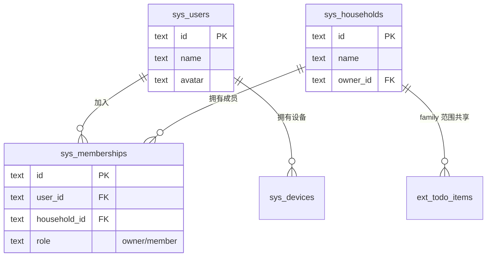

# 多用户协作演进设计（ADR-005）

> 状态：预留已落地 · 2026-11-23
> 目标：当前个人单机工作台，未来可平滑升级为家庭工作台（多人协作），且升级时业务代码零改动。
> 关联：[database-design.md](database-design.md) · [sync-protocol.md](sync-protocol.md) · [architecture.md](architecture.md)

## 1. 背景与决策

当前 WorkHub 是单人单机应用：只有一个隐含用户，所有数据默认"我的"。但产品愿景是从个人工作台升级为**家庭工作台**——多个家庭成员各自登录，在自己的设备上使用，部分数据私有、部分家庭共享（如家庭待办、购物清单、日程）。

**决策**：不在现在实现登录/协作 UI，但把**数据模型与身份抽象**的口子全部预留好，保证未来升级只接后端、不改业务表结构与 DAO 调用。

**核心原则**：

1. **单机行为零变化**：默认用户 `me`、默认家庭 `home`、默认可见范围 `private`，不弹登录、不改任何现有界面
2. **归属进 meta，不改业务表列**：ownerId/scope/householdId 存进记录 `meta` JSON，遵循"低频字段先进 meta"既有约定
3. **身份集中抽象**：所有"当前是谁/属于哪个家庭"都通过 `js/identity.js` 读取，业务层不写死

## 2. 现状盘点（预留前）

| 维度 | 已有 | 缺口 |
|---|---|---|
| 用户表 | `sys_users`，默认 `me` | 只有一行占位，无身份上下文 |
| 设备 | `sys_devices.user_id` 预留 | 设备归属了用户，但无"当前用户"概念 |
| 偏好 | `sys_settings.scope` | 只区分 user/device/global，与业务可见性无关 |
| 同步元数据 | `meta.updatedBy` = deviceId | 只认设备，无用户/归属/可见性 |
| 同步协议 | LWW + outbox + 软删 | 写了"按 user 隔离"但未落地 |
| 家庭/成员 | 无 | 完全缺失 |

## 3. 已落地的预留

### 3.1 身份上下文 `js/identity.js`

统一 API，单机默认值写死在常量里：

```js
getCurrentUserId()      // 'me'（未来=登录用户 id）
getCurrentUserName()    // '我'
setCurrentUser(id, name)// 登录态写入，触发 bus 'user:change'
currentUser()           // { id, name }

getCurrentHouseholdId() // 'home'
setCurrentHousehold(id) // 触发 bus 'household:change'

getDefaultScope()       // 'private'
setDefaultScope(scope)  // private | family | shared

ownershipMeta(opts)     // → { ownerId, scope, householdId }，合并进 meta
isOwner(record)         // 权限判定预留
```

### 3.2 系统表（v5 新增）

```sql
sys_households（家庭/协作空间）
  id, name, owner_id, created_at, updated_at, deleted_at, rev, meta

sys_memberships（成员关系）
  id, user_id, household_id, role(owner|member), joined_at, updated_at, meta
  UNIQUE(user_id, household_id)
```

启动时 `seedBase()` 幂等写入：默认用户 `me`、默认家庭 `home`、`me` 作为 `home` 的 owner 成员。多用户升级时只需 `upsertUser()` + `addMember()` 加人，不改表。

配套 API：`upsertUser` / `upsertHousehold` / `addMember` / `setMemberRole` / `listMembers` / `listHouseholdsOf`。

### 3.3 记录归属元数据（进 meta）

`data.js` 的 `newMeta()` / `touch()` 自动打标：

```js
meta: {
  updatedAt,          // LWW 时间戳
  updatedBy,          // deviceId，平局判定（不变）
  userId,             // 创建/最后修改者（单机=me），审计维度
  ownerId,            // 归属用户（单机=me）
  scope,              // private | family | shared（单机=private）
  householdId,        // 所属家庭（单机=home）
  deletedAt, rev,
}
```

归属字段随 meta 整包 JSON 落库，**无需改任何业务表列、无需数据迁移**。未来按用户/家庭高频过滤时，再用 `COLUMN_MIGRATIONS` 把 `owner_id`/`scope` 提升为正式列并建索引。

### 3.4 LWW 与多用户

保持 `updatedBy`(deviceId) 做平局判定——因为**同一用户多设备**也需要收敛到一致结果。用户维度体现在：

- `meta.userId`：谁改的（审计/展示）
- `meta.ownerId` + `scope`：数据归属与可见范围（同步时服务端据此决定推给谁）

## 4. 数据模型（未来完整形态）



## 5. 可见性与权限（未来规则草案）

| scope | 含义 | 可见者 | 可编辑者 |
|---|---|---|---|
| `private` | 仅自己 | owner | owner |
| `family` | 家庭成员 | 同 household 成员 | owner（未来可放宽为成员） |
| `shared` | 指定对象 | owner + 显式授权者 | 按 ACL（meta.acl 预留） |

> 当前单机全部记录为 `private`，权限判定代码已预留 `isOwner()`，但不启用过滤。

## 6. 分阶段演进路线

| 阶段 | 内容 | 状态 |
|---|---|---|
| 0 | 身份上下文 + 家庭/成员表 + 归属 meta 预留 | ✅ 本轮完成 |
| 1 | 登录（邮箱/手机号），`setCurrentUser()` 接入真实身份 | ⬜ |
| 2 | 家庭成员管理 UI（邀请、角色），复用 `addMember/listMembers` | ⬜ |
| 3 | 可见范围选择（private/family），写路径带 scope | ⬜ |
| 4 | CloudAdapter 按 household 过滤推送，`owner_id`/`scope` 提升正式列 | ⬜ |
| 5 | 细粒度 ACL / 字段级冲突（CRDT） | ⬜ |

## 7. 单机零变化保证

- 默认 `currentUserId='me'`、`currentHouseholdId='home'`、scope=`private`，与升级前行为一致
- 不弹出登录、不新增单机用户可见的界面
- 所有新增 API 都是"可选调用"：不调用时行为等同旧版
- 归属字段是 meta 的附加信息，现有视图与同步逻辑忽略它即可正常工作

## 8. 风险

- ⚠️ meta 归属字段若无索引，未来按用户过滤需全表扫 → 阶段 4 提升为正式列 + 索引
- ⚠️ 多用户共享同一条记录的编辑冲突仍是记录级 LWW → 阶段 5 升级字段级/CRDT
- ⚠️ owner 删除后家庭无主 → 未来需 owner 转移流程
- ⚠️ 身份切换到另一个 user 时，localStorage 里的私有数据仍在本地 → 阶段 1 需按 user 隔离本地存储或明确"设备归用户"策略
